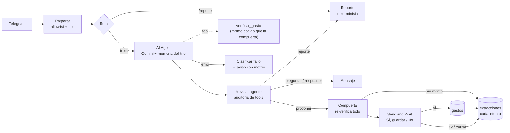

# family-expense-bot

Bot de Telegram para que una familia registre gastos en texto libre
("200 dólares supermercado"). El sistema extrae monto, categoría, fecha, a
quién corresponde el gasto y una descripción con un LLM gratuito, pide
confirmación y guarda el gasto para un reporte mensual.

> **Estado: Fase 4.** Pipeline completo: captura → extracción verificada →
> confirmación humana → almacenamiento → reporte mensual con métrica de calidad.
>
> Hay una **segunda implementación en n8n** (`n8n/`): el mismo problema
> resuelto con un agente que decide el flujo, con las mismas reglas de
> verificación. Ver [Segunda implementación: n8n](#segunda-implementación-n8n).

## Pipeline (objetivo)

captura → extracción estructurada con confianza por campo → confirmación
humana → almacenamiento → reporte

## Cómo se decide si un gasto es confiable

El LLM propone; el sistema verifica. La confianza que un modelo se asigna a
sí mismo no es evidencia: dice "alta" con la misma soltura cuando acierta que
cuando inventa. Por eso cada campo pasa por una regla determinista:

| Campo | Verificación | Si falla |
|---|---|---|
| monto | El número debe aparecer **literalmente** en el mensaje | confianza `baja` |
| monto | Debe ser positivo | se descarta |
| categoría | Debe existir en `config/categories.yaml` | cae en `otros`, confianza `baja` |
| fecha | No puede estar en el futuro ni tener más de un año | confianza `baja` |
| fecha | Si el mensaje no la menciona, se asume hoy | confianza `media` |
| atribución | Si el mensaje no dice de quién es, se asume quien escribe | confianza `media` |
| atribución | Otra persona solo se acepta si el mensaje la nombra | confianza `baja` |
| atribución | `casa` solo se acepta si el mensaje lo dice explícitamente | confianza `baja` |

Todo lo que no quede en `alta` se le muestra a la persona antes de guardar,
siempre con una nota que explica por qué. `GastoExtraido` es inmutable.

## Dos dimensiones: en qué y de quién

Cada gasto tiene una **categoría** (en qué se gastó) y una **atribución** (a
quién le corresponde el costo). Son independientes, y las dos viven en
`config/categories.yaml`, no en el código.

**La atribución es quién asume el costo**, no quién pagó en la caja ni quién
se beneficia. "Pagué la pensión de mi hija" nombra a la beneficiaria pero no
dice de qué bolsillo salió la plata, así que queda en duda. `casa` es el gasto
compartido 50/50 entre los papás, y **nunca se deduce**: ni de quién escribe,
ni del tipo de gasto. Solo cuenta si el mensaje lo dice ("gasto de la casa").

**Los parentescos dependen de quién habla.** "Mi hermana" escrito por el hijo
es la hija de la familia; escrito por la mamá es una tía, que no está en la
lista. Por eso el yaml tiene una tabla de cómo cada remitente llama a cada
persona, y el mapa de ID de Telegram → rol vive en `.env` (`TELEGRAM_USUARIOS`),
porque los IDs son datos personales.

**El LLM cita; el código resuelve.** Al principio el LLM elegía el rol
directamente. Contra `gemini-3.5-flash-lite` eso fallaba siempre en un caso:
"mi hija pagó 45 de ropa con su plata", escrito por la mamá o por el papá,
nunca llegaba al rol `hermana`. El nombre del rol contradice el parentesco,
y ni una descripción en prosa, ni una tabla explícita de parentescos en el
prompt, ni reescribir el ejemplo del prompt lo corrigieron. En cambio, "mi
esposo" → `papa` funcionó en todos los intentos, porque ahí el nombre no
contradice nada.

Ahora el LLM solo copia la frase ("mi hija"), igual que copia el monto, y el
código la resuelve con la tabla del yaml. Con ese diseño, esta batería salió
10 de 10 contra el modelo real:

| Quien escribe | Mensaje | Resultado |
|---|---|---|
| mamá | mi hija pagó 45 de ropa con su plata | `hermana`, alta |
| papá | mi hija pagó 45 de ropa con su plata | `hermana`, alta |
| mamá | mi esposo pagó 60 de zapatos con su plata | `papa`, alta |
| hijo | mi ñaña pagó 30 del cine con su plata | `hermana`, alta |
| hijo | mi hermana pagó 45 de ropa con su plata | `hermana`, alta |
| mamá | mi hermana pagó 45 de ropa con su plata | `mama`, baja (es una tía) |
| papá | 300 de la pensión de mi hija | `papa`, baja (beneficiaria, no pagadora) |
| mamá | 80 de gasolina, gasto de la casa | `casa`, alta |
| papá | 300 de pensión | `papa`, baja |
| mamá | 200 dólares supermercado | `mama`, media (asumido) |

Son 10 mensajes corridos una vez: muestran que el caso que fallaba ya no
falla, no son una tasa de acierto. La tasa real sale del reporte de calidad
con uso real. Efecto secundario bueno: al LLM ya no le llega quién escribe
ni quiénes son la familia.

**Corregir la atribución cuesta un toque.** La confirmación trae botones para
cambiar a quién corresponde el gasto sin reescribir el mensaje. Eso importa
porque el caso más común (el súper, que suele ser de la casa) es justo el que
el valor por defecto atribuye mal.

**Categorías candidatas.** `salud` y `servicios` están en el yaml marcadas
`candidata: true`: el LLM no las ve y el parser no las acepta hasta que la
familia las confirme. Así no entra ningún dato real bajo una categoría que
después podría desaparecer.

## Setup

```bash
python3 -m venv .venv
source .venv/bin/activate
pip install -e '.[dev]'
cp .env.example .env   # pega aquí el token de @BotFather
family-expense-bot --check   # valida el token contra la API de Telegram
family-expense-bot --extraer "200 dólares mercado"   # prueba el parser (usa Gemini)
family-expense-bot --exportar   # CSV para Power BI (queda fuera de git)
family-expense-bot           # levanta el bot (modo polling)
```

En Telegram, `/reporte` devuelve el total del mes por categoría.

El token vive solo en `.env`. Si alguna vez se filtra (por ejemplo, pegado en
un chat o en una captura), revócalo con `/revoke` en @BotFather: quien lo
tenga puede leer los mensajes del bot y responder como si fuera él.

## Calidad

```bash
pytest && ruff check . && ruff format --check . && mypy
```

`pytest` incluye la paridad con la versión n8n y sus tests de `node --test`
(hace falta Node 24; sin Node, esos tests se saltan con un motivo visible).
Las pruebas E2E de n8n van aparte porque levantan Docker:

```bash
node --test n8n/e2e/e2e.test.mjs   # ~2 min: n8n real + Telegram y Gemini falsos
```

## Flujo de confirmación

1. Llega el mensaje. Si el ID de Telegram no está autorizado, se ignora en
   silencio y se loguea (nunca se llama al LLM por un desconocido).
2. El bot responde "Leyendo tu mensaje..." al instante, para que nadie se
   quede mirando un chat mudo.
3. Se extrae con un límite de 45 s impuesto por el bot (una extracción normal
   toma ~3 s). Si se pasa, si se agota la cuota del LLM o si falla cualquier
   otra cosa, se avisa con el motivo. El bot nunca muere por eso.
4. Se muestra lo entendido, con ❓ en cada campo dudoso y las notas que lo
   explican. Debajo, "Sí, guardar" / "No", y una fila para cambiar a quién
   corresponde el gasto. Cambiarlo no guarda: vuelve a mostrar el resumen,
   con ✏️ en lo corregido, y espera el sí.
5. **Solo al tocar "Sí, guardar" se escribe en la base.** Si dice que no, se
   descarta y se le pide reescribirlo.

Las extracciones sin confirmar viven en memoria, nunca en disco. Si el bot se
reinicia, un botón viejo ya no guarda nada: responde como descartado.

## Almacenamiento

Solo se guardan gastos **confirmados por una persona**; las extracciones sin
confirmar viven en memoria y se descartan si se rechazan. Decisiones del
esquema (`src/family_expense_bot/storage/`):

- **Montos en centavos, como enteros.** En punto flotante, `0.1 + 0.2` no da
  `0.3`; sumar gastos de una familia durante un año arrastraría ese error.
- **Nada se borra.** `anular()` marca el gasto con fecha y motivo. El historial
  queda auditable, que es lo mínimo cuando es dinero de otras personas.
- **Se guarda cómo se extrajo cada gasto** (la confianza por campo y si hubo
  corrección manual). Es el insumo del reporte de calidad de la Fase 4.
- **Quien registra y a quien se atribuye son columnas distintas.** La mamá
  puede registrar un gasto de la hija.
- **El esquema se verifica al arrancar.** `create_all` crea tablas nuevas pero
  no agrega columnas a las existentes, así que una base vieja arrancaría normal
  y se caería en el primer insert, en medio de una conversación. Ahora el bot
  no arranca y dice qué columnas faltan.

## Reporte de calidad

La pregunta que el proyecto se hace a sí mismo es *¿qué tan bien lee el LLM lo
que escribe la familia?*, y responderla honestamente exige una decisión de
diseño que no es obvia: **se registra cada extracción, no solo las que se
guardaron.**

Si la medición saliera de la tabla `gastos`, daría 100% de acierto siempre,
porque ahí solo llegan las confirmadas — sesgo del superviviente. Por eso
existe la tabla `extracciones`, que guarda el veredicto (confirmada o no) y
las confianzas por campo. A propósito **no** guarda montos ni el texto del
mensaje: son gastos que nadie confirmó, y para medir calidad no hacen falta.

Tres métricas salen de ahí:

- **Acierto directo** (la métrica del proyecto): de todos los mensajes leídos,
  cuántos se guardaron tal cual, sin rechazo y sin tocar ningún botón de
  corrección. Las confianzas registradas son las del LLM, no las que quedan
  después de que una persona corrige.
- **Tasa de confirmación:** cuántos se guardaron, con o sin corrección.
- **Tasa sin dudas:** cuántas extracciones salieron con los cuatro campos en
  confianza alta.

## Privacidad

El repo es público. La base de datos, los exports y el `.env` están en
`.gitignore` desde el primer commit, y `tests/test_privacy.py` verifica que
sigan excluidos. Los ejemplos y capturas usan solo datos sintéticos.

Una vez falló igual: `.env.example`, que sí se versiona, llegó a tener el
token del bot y la API key pegados. No alcanzó a publicarse, pero estaba en
seis commits. Se limpió el historial con `git filter-repo --replace-text`
antes del primer push, y desde entonces `test_privacy.py` exige que las
variables secretas de los `.env.example` vayan vacías y busca patrones de
tokens en **todos los objetos del historial de git**, no solo en la versión
actual: un push publica el historial completo.

En la versión n8n, las credenciales viven cifradas en la base de n8n
(`n8n/.datos/`, ignorada), el workflow exportado solo tiene referencias
(`id` y `name`), y los IDs de Telegram entran por el entorno. Las ejecuciones
exitosas llevan montos y el texto del mensaje, así que el workflow pide no
guardarlas. Ojo: la prueba real mostró que n8n no las borra al terminar, solo
las marca como borradas; los datos siguen en la base local hasta la purga
física, cerca de una hora después (`EXECUTIONS_DATA_HARD_DELETE_BUFFER`). Las
fallidas se guardan a propósito, para depurarlas, y se purgan a los 7 días.

## Decisiones y limitaciones

- **Plataforma: Telegram.** Tiene API gratuita y no pide aprobación. Hoy los
  usuarios no usan Telegram, así que instalarlo es una fricción de adopción
  real: justo lo que el proyecto busca minimizar. WhatsApp se descartó
  porque la Business API exige aprobación de Meta y no apunta a uso personal.
- **LLM: Gemini** (`gemini-3.5-flash-lite`), por su salida estructurada
  nativa. El modelo importa más de lo esperado. Medido con el prompt real de
  este proyecto, mismo mensaje:

  | Modelo | Tiempo | Resultado |
  |---|---|---|
  | `gemini-3.8-flash` | 109 s | HTTP 429: 20 requests/día en el plan gratuito |
  | `gemini-3.5-flash` | 15.3 s | ok |
  | `gemini-3.5-flash-lite` | **2.8 s** | ok |

  El límite de 20 requests diarios de los modelos grandes hace inviable un bot
  familiar: tres personas registrando gastos lo agotan en un día. `flash-lite`
  es además cinco veces más rápido. El parser depende de un protocolo
  `ClienteLLM`, así que cambiar de modelo o de proveedor (`GEMINI_MODELO` en
  `.env`) no toca la lógica de verificación.
- **La cuota diaria es el límite real, no la velocidad.** Con `flash-lite`
  una extracción toma ~3 s, pero el plan gratuito tiene un tope de requests
  por día que se ve en https://aistudio.google.com/rate-limit. Al agotarse,
  el bot lo dice explícitamente ("vuelve mañana") en vez de fingir que no
  entendió. Cuántos gastos diarios aguanta la familia es algo que hay que
  medir con uso real.
- **Solo dólares.** No se guarda la moneda; se asume USD (Ecuador).
- **La confianza que el modelo declara no es estable.** El mismo mensaje sin
  dueño ("200 dólares supermercado") salió una vez con confianza `alta` y otra
  con `baja` en la atribución. Los dos resultados son seguros (el gasto queda
  del remitente, con ❓), pero es ruido que la tasa sin dudas va a registrar.
- **"X se compró Y" cuenta como que X asume el costo.** Si la hija se compró
  ropa con la tarjeta de los papás, el bot la atribuye a la hija con confianza
  alta. Se ve en la confirmación ("De: Hermana") y se corrige con un toque,
  pero no lleva ❓.
- **Un gasto por mensaje.** "20 de gasolina y 8 del almuerzo" se extrae como
  uno solo y queda marcado con confianza baja para que la persona corrija.

## Segunda implementación: n8n

El mismo problema, resuelto con un agente en n8n en vez de un pipeline lineal.
El núcleo Python no cambió: esto vive entero en `n8n/`. La pregunta que
responde es **qué se gana y qué se pierde cuando el LLM decide el flujo**, sin
renunciar a "el LLM propone, el código verifica".

### Arquitectura del flujo



El agente decide **qué hacer** con el mensaje: `proponer` un gasto,
`preguntar` lo que falta, pedir el `reporte` o `responder`. No decide **qué
se guarda**: eso lo deciden una compuerta de código y una persona.

- **La compuerta re-verifica desde cero.** En un agente, lo que devuelve una
  tool vuelve a pasar por el LLM, que podría leer "confianza baja" y escribir
  "alta". Por eso la tool `verificar_gasto` solo le sirve al agente para
  decidir si pregunta; después del agente, un Code node vuelve a aplicar
  todas las reglas de la tabla de arriba sobre lo que el agente *afirma*, sin
  mirar lo que dijo la tool. Tool y compuerta corren el mismo código.
- **El LLM cita, el código resuelve, también acá.** El esquema de salida del
  agente tiene `quien_paga` (la frase) y no tiene campo de rol. El agente no
  recibe quién escribe ni la tabla de parentescos, y los parámetros `texto`,
  `remitente` y `hoy` de la tool los inyecta el workflow: el modelo solo ve
  los campos que puede afirmar.
- **Guardar exige confirmación por estructura, no por prompt.** El agente no
  tiene tool para guardar. El único nodo que escribe en `gastos` cuelga de la
  salida "aprobado" del Send and Wait de Telegram, y un test recorre el grafo
  de `workflow.json` y falla si aparece cualquier camino al guardado que evite
  la confirmación.
- **Cada intento se registra.** Todas las salidas desembocan en un único nodo
  que escribe en `extracciones` (sin montos ni texto): confirmada, rechazada,
  expirada, sin monto, error al guardar, y dos que solo existen porque hay un
  agente: `no_propuesto` (el agente no propuso nada y el mensaje traía un
  número) y `abandonada` (el agente preguntó y nadie respondió).
- **El reporte no pasa por el LLM.** Al principio era una tool; se sacó para
  que los totales de la familia nunca lleguen a Gemini. El agente solo pide
  `accion: "reporte"` y el workflow manda el mismo reporte determinista de
  `/reporte`. El E2E verifica que los montos no aparezcan en ningún request.

### Decisiones de implementación

- **Un solo código de verificación, probado contra Python.** Las reglas están
  portadas a JavaScript en `n8n/lib/` (funciones puras). `tests/test_n8n_paridad.py`
  corre ~10.000 casos en las dos implementaciones y compara el resultado
  completo, notas incluidas, con Python como oráculo: las 22 fixtures, la
  batería de 10 de arriba, cada cita del yaml desde cada remitente, montos,
  fechas y todo el texto que ve la persona. Hubo que reimplementar a mano lo
  que JS hace distinto (`\b` y `strip()` de Python son Unicode; `repr()` para
  que las notas coincidan). Una diferencia queda a propósito y con test: JS
  solo acepta dígitos ASCII, lo que puede bajar la confianza de un monto,
  nunca aceptar uno que no debía.
- **`workflow.json` se genera.** n8n no deja compartir código entre Code
  nodes, así que `n8n/build.mjs` pega la biblioteca y la taxonomía en cada
  uno y arma el grafo. Por eso pesa ~280 KB. Lo que se lee y se revisa son
  `n8n/lib/`, `n8n/nodos/` y `build.mjs`; un test falla si el JSON no
  coincide con sus fuentes.
- **La taxonomía sigue siendo el yaml.** `n8n/taxonomia.json` se exporta con
  `cargar_taxonomia`, así que las validaciones de Python corren antes, y un
  test exige que esté sincronizado.
- **El hilo respalda el monto.** Si el agente pregunta "¿cuánto fue?", la
  respuesta "40" cuenta como escrita. El monto se verifica contra los
  mensajes del hilo abierto, que se cierra al proponer o responder: un monto
  ya guardado no respalda un gasto nuevo. Cada hilo es además la sesión de la
  memoria del agente, así que uno nuevo empieza sin memoria.
- **El estado solo se toca antes de esperar.** Una ejecución que se reanuda
  tras la confirmación guarda su copia vieja del estado de n8n; si lo tocara,
  pisaría los hilos abiertos entretanto. Un test verifica que ningún nodo
  posterior a la espera lo use.
- **Las tablas se crean solas** (`createIfNotExists` en cada mensaje
  autorizado): el CLI de n8n no puede crearlas, porque `n8n execute` no carga
  el módulo de Data Tables. Instalar es importar y publicar.

### Cómo se probó

Tres capas, todas sin tokens reales:

1. **Paridad con Python** (pytest): la lógica de verificación y los textos.
2. **Invariantes del grafo** (`node --test n8n/test/`): guardar solo tras
   confirmar, una sola tool, entradas inyectadas, salida de error conectada,
   cada resultado registrado, Markdown escapado, cada tipo de nodo existente
   en n8n 2.40.7. Se comprobó metiendo una conexión prohibida a mano: el test
   la detecta.
3. **E2E en n8n real** (`n8n/e2e/`): 17 escenarios contra n8n 2.40.7 en
   Docker. `falsos.mjs` imita la API de Telegram (incluida su validación de
   Markdown) y la de Gemini con un guion por escenario; las credenciales de
   n8n apuntan ahí.

Correrlo de verdad mostró cosas que leer el código de n8n no dejaba ver, y
varias cambiaron el diseño:

| Hallazgo (n8n 2.40.7) | Consecuencia |
|---|---|
| El Send and Wait de Telegram siempre manda `parse_mode: Markdown`; `comida_fuera` rompía la confirmación | Todo texto se escapa al salir |
| Si nadie responde a tiempo, el Send and Wait devuelve su entrada sin `data.approved` | Así se distingue "expirada" de "rechazada" |
| Los enlaces de aprobación ignoran en silencio los User-Agent de bots | Una vista previa del enlace no aprueba sola |
| Ante un 429 de Gemini hay un solo intento, y n8n lo reescribe como "too many requests" | El clasificador lo reconoce; el aviso llega al instante |
| La tool responde con los items de su último nodo, como texto JSON | La auditoría lo interpreta así |
| La salida estructurada del agente es otra tool, `format_final_json_response` | La auditoría no la cuenta como tool nuestra |

### Python vs. n8n

| | Python | n8n |
|---|---|---|
| Quién decide el flujo | El código: todo mensaje es un gasto | El agente: proponer, preguntar, reporte o responder |
| Verificación | `parser.py`, después de la llamada | Compuerta después del agente, mismas reglas (paridad) |
| Requests al LLM por mensaje | 1 | 1; +1 si usa `verificar_gasto`; +1 si llama una tool inexistente (medido en el E2E) |
| Mensaje sin monto | Se pide reescribirlo | El agente pregunta y la respuesta respalda el monto |
| Consultas ("¿cuánto va el mes?") | Solo `/reporte` | También en lenguaje natural |
| Corregir de quién es | Un toque | Decir que no y reescribir |
| Confirmación pendiente | En memoria; se pierde al reiniciar | En la base de n8n; sobrevive reinicios, vence a las 12 h |
| Infraestructura | Polling, sin puertos abiertos | Webhook HTTPS público (túnel) |
| Fallos | Excepciones tipadas, en un solo lugar | Salida de error del agente, auditoría de sus pasos, Error Workflow |
| Cambiar una regla | Editar Python | Editar `n8n/lib/`, `node n8n/build.mjs`, reimportar |
| Tests | pytest, sin red | pytest + `node --test` + E2E con Docker |

**Lo que gana el agente:** conversación. Pregunta lo que falta en vez de
rechazar, entiende consultas en lenguaje natural y separa un saludo de un
gasto. El costo de esas decisiones se ve en la tabla de intentos: el agente
puede decidir no registrar (`no_propuesto`) o quedarse esperando una
respuesta que no llega (`abandonada`), dos fallos que en Python no existen.

**Lo que pierde:** simplicidad y control. Más requests contra una cuota que ya
es el límite real, una confirmación de un toque que exige HTTPS público, una
corrección que cuesta reescribir, y fallos que el motor esconde (abajo). La
lógica de negocio tampoco sale gratis: sigue siendo código, ahora embebido en
nodos y sostenido por un build.

**Lo que no cambia:** el agente no valida su propia confianza, no elige el
parentesco y no puede guardar. Eso lo garantiza la estructura, no el prompt.
Para este problema, con dinero real y pocos usuarios, la versión Python es la
más simple de sostener; n8n tiene sentido si el bot creciera hacia conversación o si
quien lo mantiene prefiere un flujo visual.

### Limitaciones (n8n)

- **Una tool inexistente falla en silencio, y no hay cómo evitarlo desde el
  workflow.** n8n 2.40.7 descarta la llamada del modelo a una tool que no
  existe (`createEngineRequests` la filtra) y vuelve a llamar al modelo como
  si nada: cuesta un request y no queda rastro. Ningún nodo puede leer la
  respuesta cruda del modelo (se probó). No tiene efecto, porque guardar no es
  una tool, pero incumple "nunca fallar en silencio". Un test de
  caracterización fija el comportamiento actual y va a avisar si cambia.
- **No se probó contra Telegram ni Gemini reales**, solo contra los falsos.
  Falta una prueba de humo con un bot y una key de verdad.
- **La confirmación de un toque no se probó.** Sin HTTPS público, n8n cae a
  botones con enlace que abren el navegador, y solo lo anota en el log. El
  E2E prueba ese modo; el de un toque (que además restringe quién puede
  aprobar) necesita el túnel.
- **Dos mensajes simultáneos del mismo chat pueden pisar el hilo:** el estado
  de n8n es "gana la última escritura". Con una familia escribiendo a mano es
  improbable, pero posible.
- **La métrica de calidad no es comparable uno a uno.** El acierto directo se
  calcula igual, pero acá no hay botones de corrección (`corregida` siempre es
  falso) y hay resultados que Python no tiene.
- **Un bot por implementación.** Telegram entrega a un webhook o a polling,
  no a los dos: la versión n8n necesita su propio bot de @BotFather.

### Instalación (n8n)

```bash
cp n8n/.env.example n8n/.env                           # completar
cp n8n/credenciales.ejemplo.json n8n/credenciales.json # token del bot n8n y API key
cloudflared tunnel --url http://localhost:5678         # en otra terminal; la URL va a N8N_WEBHOOK_URL
n8n/instalar.sh
```

`instalar.sh` importa las credenciales (y vacía `credenciales.json`: el token
queda cifrado en n8n), importa y publica el workflow, y reinicia n8n para que
registre el webhook en Telegram. El túnel rápido de cloudflared cambia de URL
cada vez que arranca; con otra URL hay que actualizar `n8n/.env` y reiniciar.
