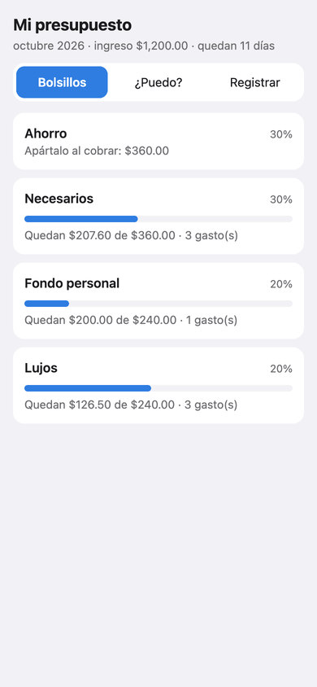
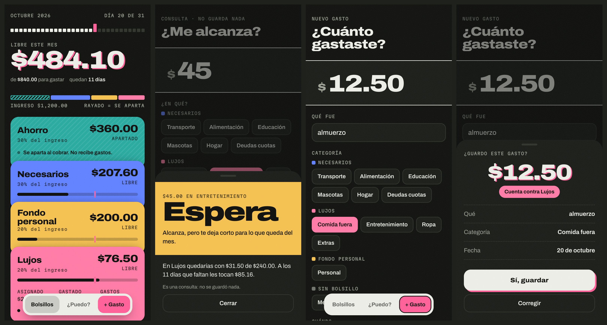

# Mini App

[← README](../README.md) · [Decisiones](decisiones.md) · [Presupuesto](presupuesto.md) · [Calidad](calidad.md) · [Mini App](mini-app.md) · [n8n](../n8n/README.md)



En tema oscuro (lo decide Telegram):



Capturas generadas con `scripts/capturas.py`: la app real, sobre una base temporal con gastos inventados.

## Qué es

**Diseño: impreso en risografía.** Tintas planas, grano y la segunda tinta un poco
corrida en los números grandes. Cada bolsillo es un **sobre de su color** (Ahorro,
rayado porque se aparta; Necesarios, Fondo personal y Lujos), y las categorías del
formulario son fichas del color de su sobre, así que se aprende contra qué bolsillo
cuenta un gasto sin leerlo. Arriba, el mes es una regla de días con hoy en rosa, y
la misma marca rosa va en cada barra: si lo gastado la pasa, vas más rápido que el
mes, que es el umbral de la regla del ritmo de "¿puedo?". No hay menús desplegables:
categoría y fecha se eligen con un toque, y la confirmación y el veredicto suben en
una hoja desde abajo. Títulos y montos van en Archivo ancho; las etiquetas, en Martian
Mono. Telegram decide si el tema es claro u oscuro.

Una **Telegram Mini App**: una página que se abre desde el botón de menú del
mismo bot. Tiene tres pestañas:

- **Bolsillos:** lo que queda libre en el mes y los cuatro bolsillos, con cuánto se asignó, cuánto se
  gastó y cuánto queda. Es el mismo `resumen_presupuesto` de `/presupuesto`.
- **¿Puedo?:** monto y categoría, y el veredicto de `evaluar_gasto`, la misma
  regla del ritmo que `/puedo`. Como no hay texto libre, **no pasa por el LLM** ni
  gasta cuota. Si el bolsillo no alcanza pero el fondo sí, ofrece probar desde el fondo.
- **Registrar:** un formulario campo por campo, para cuando escribir una
  frase es más lento que llenar cuatro casillas.

Es otra capa de I/O, igual que el bot: las rutas (`src/family_expense_bot/app/api.py`)
no tienen lógica de negocio. Lo único nuevo es `extraction/formulario.py`, que
valida el formulario con las reglas del chat:

| Regla del chat | En el formulario |
|---|---|
| Nada se guarda sin el sí | "Revisar" muestra el resumen y no guarda; solo "Sí, guardar" escribe. El servidor exige `confirmado: true` y vuelve a validar todo |
| La atribución por defecto nunca es `alta` | La app es el presupuesto personal de quien la abre: todo gasto es suyo, sin "¿de quién es?". No es deducir: registrar en tu app es decirlo. Un `atribuido_a` en el cuerpo se ignora, así que no se puede cargar un gasto a otra persona |
| "Del fondo" se dice, no se deduce | Es un interruptor explícito, que agrega el marcador del yaml al texto guardado. `bolsillo_de` lo resuelve al leer, igual que en el chat |
| Solo categorías activas | La lista no trae las `candidata: true`, y el servidor las rechaza |
| Montos verificados | Formato estricto (dígitos y hasta dos decimales). Lo que no cuadra se rechaza con el motivo, no se adivina |

**Identidad sin login.** Telegram le entrega a la Mini App un `initData`
firmado con el token del bot. El servidor verifica la firma (HMAC-SHA256,
algoritmo oficial), rechaza las de más de 24 h y pasa el ID por la misma
allowlist de `TELEGRAM_USUARIOS`. La página en sí no trae datos: abierta en
un navegador común solo dice "ábrela desde el bot".

**El reporte de calidad no se infla.** Los gastos del formulario se guardan
con `origen = formulario` y **no** se registran en `extracciones`. Ahí nadie
leyó nada con el LLM, y contarlos subiría el acierto directo sin que el modelo
haya acertado nada.

```bash
family-expense-bot --migrar                        # solo si la base es de antes de la app
family-expense-bot --app                           # http://127.0.0.1:8080, solo local
cloudflared tunnel --url http://localhost:8080     # en otra terminal: da una URL https
# pon esa URL en APP_URL (.env) y reinicia el bot: registra el botón de menú
```

Limitaciones:

- **Funciona solo con la Mac prendida.** La base vive ahí a propósito: los
  datos no salen de la máquina. La contracara es que no hay app sin Mac.
- **La URL del túnel rápido cambia en cada arranque.** Hay que actualizar
  `APP_URL` y reiniciar el bot. Un túnel con nombre y un dominio propio lo
  resolvería, pero no está hecho.
- **El bot y la app son dos procesos sobre el mismo SQLite.** Con una persona
  registrando a mano alcanza (SQLite serializa las escrituras), pero no es
  para muchos usuarios.
- **La versión n8n no tiene app.** La app lee y escribe la base de Python. No
  cambia ninguna regla del presupuesto, así que la paridad no se toca.
- **No hay historial ni anulación desde la app**, todavía. `anular()` ya
  existe en el repositorio.
