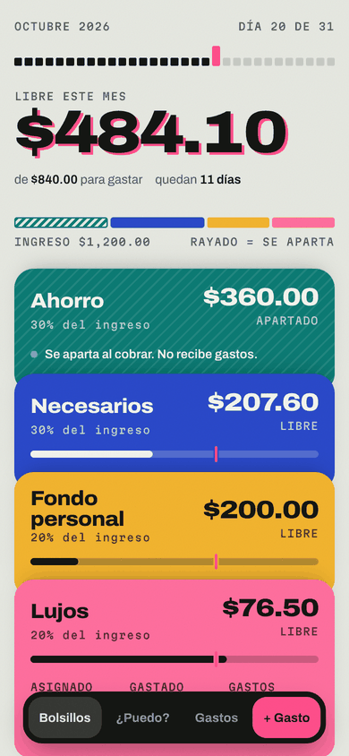
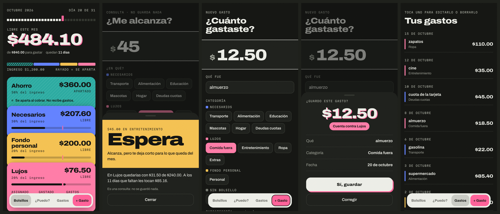

# Mini App

[← README](../README.md) · [Decisiones](decisiones.md) · [Presupuesto](presupuesto.md) · [Calidad](calidad.md) · [Evaluación](evaluacion.md) · [Mini App](mini-app.md) · [n8n](../n8n/README.md)



En tema oscuro (lo decide Telegram):



Capturas generadas con `scripts/capturas.py`: la app real, sobre una base temporal con gastos inventados.

## Qué es

**Diseño: impreso en risografía.** Tintas planas, grano y la segunda tinta un poco
corrida en los números grandes. Cada bolsillo es un **sobre de su color** (Ahorro,
rayado porque se aparta; Necesarios, Fondo personal y Lujos), y las categorías del
formulario son fichas del color de su sobre, así que se aprende contra qué bolsillo
cuenta un gasto sin leerlo. Arriba, el mes es una regla de días con hoy en rosa, y
la misma marca rosa va en cada barra: si lo gastado la pasa, vas más rápido que el
mes, que es el umbral de la regla del ritmo de "¿puedo?". No hay menús desplegables:
categoría y fecha se eligen con un toque, y la confirmación y el veredicto suben en
una hoja desde abajo. Títulos y montos van en Archivo ancho; las etiquetas, en Martian
Mono. Telegram decide si el tema es claro u oscuro.

Una **Telegram Mini App**: una página que se abre desde el botón de menú del
mismo bot. Tiene cuatro pestañas:

- **Bolsillos:** lo que queda libre en el mes y los cuatro bolsillos, con cuánto se asignó, cuánto se
  gastó y cuánto queda. Es el mismo `resumen_presupuesto` de `/presupuesto`.
- **¿Puedo?:** monto y categoría, y el veredicto de `evaluar_gasto`, la misma
  regla del ritmo que `/puedo`. Como no hay texto libre, **no pasa por el LLM** ni
  gasta cuota. Si el bolsillo no alcanza pero el fondo sí, ofrece probar desde el fondo.
- **Historial:** tus últimos 60 gastos y 60 ingresos, juntos y agrupados por
  día. Los gastos llevan la tinta de su bolsillo; los ingresos van en verde y
  con "+". Al tocar uno se ve el detalle, y desde ahí se **edita** o se **borra**.
- **+ Nuevo:** un formulario campo por campo, para cuando escribir una frase es
  más lento que llenar cuatro casillas. Arriba se elige **Gasto** o **Ingreso**.
  La **subcategoría** es opcional ("Tipti" dentro de Alimentación), y la app
  sugiere las que ya usaste en esa categoría. Si eliges **Otros**, pide de qué
  bolsillo sale. Si el gasto hace cruzar el 80% o el 100% del bolsillo, llega
  una [alerta](presupuesto.md#alertas) al chat del bot.

**Ingresos extra.** Un trabajo puntual, un bono o un regalo se registran con el
mismo flujo que un gasto: Revisar, "Sí, guardar", y después editar o borrar
desde el historial. Se **suman al ingreso fijo** de `.env` en el mes de su fecha
y se reparten 30/30/20/20 como el sueldo, así que los bolsillos, "¿puedo?" y
`/presupuesto` en el chat los ven. Las categorías viven en `config/categories.yaml`
(`ingresos:`), y no hay "sueldo" a propósito: ya es el ingreso fijo, y
registrarlo lo contaría dos veces. En Bolsillos, "+ Ingreso" abre el formulario
directo.

**Editar y borrar sin perder historia.** Editar abre el mismo formulario con el
gasto cargado, y guardar pasa por "Revisar los cambios" y "Sí, guardar", como un
gasto nuevo. En la base, el gasto viejo queda anulado con el motivo `editado →
#<nuevo>` y se guarda uno nuevo, todo en una sola transacción
(`RepositorioGastos.reemplazar`): si algo falla, no cambia nada. Borrar pide "Sí,
borrar" y anula el gasto sin eliminar la fila. Solo aparecen y se pueden tocar
los gastos que registraste tú y que son tuyos: un gasto de la etapa familiar
atribuido a otra persona no está en la lista, y el servidor lo rechaza aunque
alguien mande su id.

Es otra capa de I/O, igual que el bot: las rutas (`src/family_expense_bot/app/api.py`)
no tienen lógica de negocio. Lo único nuevo es `extraction/formulario.py`, que
valida el formulario con las reglas del chat:

| Regla del chat | En el formulario |
|---|---|
| Nada se guarda sin el sí | "Revisar" muestra el resumen y no guarda; solo "Sí, guardar" escribe. El servidor exige `confirmado: true` y vuelve a validar todo |
| La atribución por defecto nunca es `alta` | La app es el presupuesto personal de quien la abre: todo gasto es suyo, sin "¿de quién es?". No es deducir: registrar en tu app es decirlo. Un `atribuido_a` en el cuerpo se ignora, así que no se puede cargar un gasto a otra persona |
| "Del fondo" se dice, no se deduce | Es un interruptor explícito, que agrega el marcador del yaml al texto guardado. `bolsillo_de` lo resuelve al leer, igual que en el chat |
| `otros` no tiene bolsillo | El formulario exige elegir uno (Necesarios, Fondo personal o Lujos). Se guarda igual que "del fondo": como marcador en el texto (`marcadores_otros` del yaml, ej. "de lujos"), y se resuelve al leer |
| Solo categorías activas | La lista no trae las `candidata: true`, y el servidor las rechaza |
| Montos verificados | Formato estricto: dígitos y hasta dos decimales, con **coma o punto** para los centavos (`12,50` o `12.50`), porque el teclado numérico del celular a veces solo trae la coma. Sin separador de miles: `1,200` se rechaza en vez de adivinar si son mil doscientos o uno con veinte |

**Identidad sin login.** Telegram le entrega a la Mini App un `initData`
firmado con el token del bot. El servidor verifica la firma (HMAC-SHA256,
algoritmo oficial), rechaza las de más de 24 h y pasa el ID por la misma
allowlist de `TELEGRAM_USUARIOS`. La página en sí no trae datos: abierta en
un navegador común solo dice "ábrela desde el bot".

**El reporte de calidad no se infla.** Los gastos del formulario se guardan
con `origen = formulario` y **no** se registran en `extracciones`. Ahí nadie
leyó nada con el LLM, y contarlos subiría el acierto directo sin que el modelo
haya acertado nada.

## Puesta en marcha (una sola vez por Mac)

Cada paso tiene su comprobación. Si un paso no se cumple, la app no abre, y el
síntoma es siempre el mismo: el botón del bot lleva a una página que no carga.

| # | Paso | Comprobación |
|---|---|---|
| 1 | Instalar Tailscale (`brew install --cask tailscale`), abrirlo e iniciar sesión | `tailscale status` muestra la Mac |
| 2 | OrbStack con arranque al iniciar sesión: `orb config set app.start_at_login true` | `orb status` → `Running` |
| 3 | `docker compose up -d` | `docker compose ps`: `app` en `(healthy)` y `curl 127.0.0.1:8080` → 200 |
| 4 | `tailscale funnel --bg 8080`. La primera vez pide activar HTTPS y Funnel en la consola de Tailscale | `tailscale funnel status` muestra `proxy http://127.0.0.1:8080` |
| 5 | Poner esa URL (`https://<mac>.<tailnet>.ts.net/`) en `APP_URL` del `.env` y correr `docker compose up -d bot` (con `restart` no relee el `.env`) | `docker compose logs bot` → `Mini App verificada: responde en APP_URL` |
| 6 | Que la Mac no se duerma enchufada: `sudo pmset -c sleep 0` | `pmset -g custom`, en `AC Power` → `sleep 0` |

**Al actualizar a una versión con columnas nuevas** (la última: `subcategoria`,
10-nov-2026), el bot y la app no arrancan y piden `--migrar`. Primero un
respaldo, después la migración, y recién ahí se levanta todo:

```bash
docker compose down
cp data/processed/gastos.db data/processed/gastos.respaldo-$(date +%Y%m%d-%H%M%S).db
docker compose run --rm bot --migrar          # agrega solo lo que falta; dos veces no hace nada
docker compose up -d --build
```

Sin Docker, los pasos 2 y 3 se reemplazan por `family-expense-bot --app` y el
bot en otra terminal (`family-expense-bot --migrar` antes, solo si la base es de
antes de la app).

Los pasos 2, 4 y 6 quedan guardados: después de reiniciar o despertar la Mac,
todo vuelve solo, con la misma URL. Lo único que hay que tener abierto es la
app de Tailscale.

### Si la Mini App no abre

El bot revisa `APP_URL` al arrancar y avisa por Telegram si no carga. Para
encontrar la falla, se recorre la tabla de arriba **de abajo hacia arriba**:

```bash
docker context show                                # tiene que decir orbstack
docker compose logs bot | grep "Mini App"          # qué vio el bot al arrancar
grep ^APP_URL .env                                 # ¿es la URL de ts.net? (trycloudflare = mal)
tailscale funnel status                            # ¿sigue el proxy a 8080?
docker compose ps                                  # ¿app healthy?
orb status                                         # ¿OrbStack prendido?
```

Casos ya vistos:

- **9-nov-2026: no abría.** `APP_URL` seguía en el túnel rápido de cloudflared
  de octubre, Tailscale nunca se había instalado y OrbStack estaba apagado. La
  documentación daba por hecho el paso 4. Desde entonces existe esta tabla y
  el bot marca cualquier `*.trycloudflare.com` como problema, aunque responda.
- **10-nov-2026: "el bot está apagado".** Eran tres cosas a la vez:
  - **Docker Desktop se instaló y se quedó con Docker.** Puso su contexto
    (`desktop-linux`) como el activo, y `docker` dejó de ver los contenedores de
    OrbStack: parecía que no había nada corriendo. Se arregla con `docker context
    use orbstack`. También dejó `"credsStore": "desktop"` en `~/.docker/config.json`,
    y sin Docker Desktop abierto `docker compose build` falla con
    `docker-credential-desktop not found`; se arregla cambiándolo a `osxkeychain`.
    Lo más simple es no tener los dos: este proyecto usa OrbStack.
  - **Se cortó la red** a las 11:23 y el bot quedó trabado en errores de DNS
    (`Temporary failure in name resolution`), aunque el contenedor seguía
    "Up". Reiniciarlo (`docker compose up -d`) lo destraba.
  - **Al desinstalar Docker Desktop quedaron enlaces rotos** en
    `~/.docker/cli-plugins/` (apuntan a `Docker.app`), así que `docker compose`
    dejó de existir ("unknown command"). Mientras tanto se puede usar el de
    OrbStack: `~/.orbstack/bin/docker-compose`. Y si el llavero de macOS no
    acepta la clave, el build falla en "error getting credentials"; la imagen
    base es pública, así que alcanza con `docker pull python:3.12-slim` y
    construir con `DOCKER_BUILDKIT=0 docker build -t family-expense-bot:local .`
    usando una config de Docker sin `credsStore`.
  - **Ojo con el orden al migrar:** `run` no acepta `--no-build`, y si la
    migración no corre, el bot nuevo no arranca y lo dice: "No arranco: …
    le faltan: gastos.subcategoria". Es lo esperado; se corre `--migrar` y se
    levanta de nuevo.
  - **Tailscale estaba detenido** (`tailscale status` → `Tailscale is stopped`),
    así que la URL pública no llegaba a la Mac aunque la app respondiera en
    local. Se arregla abriendo la app de Tailscale y conectándola; `funnel --bg`
    vuelve solo.

## Hosting y limitaciones

La app sale a internet por **Tailscale Funnel**: la URL es fija y no hace falta
un dominio propio. `--bg` deja la configuración guardada en Tailscale, así que
sobrevive a reinicios y a la Mac dormida sin tocar `APP_URL`. Por qué Funnel y
no otra cosa: [decisiones](decisiones.md#hosting).

Limitaciones:

- **Funciona solo con la Mac prendida.** La base vive ahí a propósito: los
  datos no salen de la máquina. La contracara es que no hay app sin Mac.
- **Con la Mac dormida no hay app**, pero al despertar vuelve sola, con la
  misma URL. Antes, con el túnel rápido de cloudflared, la URL cambiaba en cada
  arranque y moría con cada siesta de la Mac (error 1033).
- **Si `APP_URL` cambia**, con Docker hay que correr `docker compose up -d bot`:
  `restart` no vuelve a leer el `.env`.
- **Una app caída no se nota hasta tocar el botón**, así que el bot la revisa al
  arrancar: pide `APP_URL` por la URL pública (tres intentos, 10 s entre cada
  uno) y, si no carga o es un túnel rápido de cloudflared, avisa por Telegram
  a la allowlist. El chat sigue funcionando igual. En Docker, `docker compose
  ps` muestra la app como `unhealthy` si deja de responder.
- **Con batería la Mac se duerme igual**, y mientras duerme no hay app.
- **El bot y la app son dos procesos sobre el mismo SQLite.** Con una persona
  registrando a mano alcanza (SQLite serializa las escrituras), pero no es
  para muchos usuarios.
- **La versión n8n no tiene app.** La app lee y escribe la base de Python. No
  cambia ninguna regla del presupuesto, así que la paridad no se toca.
- **El historial muestra los últimos 60 gastos**, sin filtro por mes ni búsqueda.
- **Editar crea un gasto nuevo**, con `origen = formulario` aunque el original
  haya entrado por el chat. El reporte de calidad no cambia hacia atrás: la
  lectura del LLM ya quedó medida en `extracciones` cuando se confirmó.
- **Los ingresos extra solo existen en la app y en el bot de Python.** La
  versión n8n no los ve: su presupuesto sigue saliendo solo del fijo.
- **Un ingreso no se reparte distinto.** Siempre 30/30/20/20; no hay forma de
  mandar un regalo entero al ahorro.
- **La subcategoría solo existe en la app.** El chat no la pide y el LLM nunca
  la llena; el presupuesto y el bot la ignoran. Va en el export CSV.
