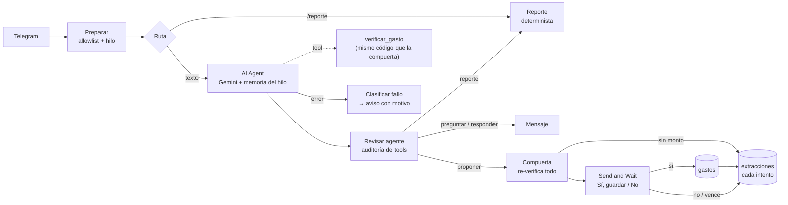

# Segunda implementación: n8n

[← README](../README.md)

El mismo problema, resuelto con un agente en n8n en vez de un pipeline lineal.
El núcleo Python no cambió: esto vive entero en `n8n/`. La pregunta que
responde es **qué se gana y qué se pierde cuando el LLM decide el flujo**, sin
renunciar a "el LLM propone, el código verifica".

## Arquitectura del flujo



El agente decide **qué hacer** con el mensaje: `proponer` un gasto,
`preguntar` lo que falta, pedir el `reporte` o el `presupuesto`, o `responder`. No decide **qué
se guarda**: eso lo deciden una compuerta de código y una persona.

- **La compuerta re-verifica desde cero.** En un agente, lo que devuelve una
  tool vuelve a pasar por el LLM, que podría leer "confianza baja" y escribir
  "alta". Por eso la tool `verificar_gasto` solo le sirve al agente para
  decidir si pregunta; después del agente, un Code node vuelve a aplicar
  todas las reglas de [verificación](../docs/decisiones.md#cómo-se-decide-si-un-gasto-es-confiable) sobre lo que el agente *afirma*, sin
  mirar lo que dijo la tool. Tool y compuerta corren el mismo código.
- **El LLM cita, el código resuelve, también acá.** El esquema de salida del
  agente tiene `quien_paga` (la frase) y no tiene campo de rol. El agente no
  recibe quién escribe ni la tabla de parentescos, y los parámetros `texto`,
  `remitente` y `hoy` de la tool los inyecta el workflow: el modelo solo ve
  los campos que puede afirmar.
- **Guardar exige confirmación por estructura, no por prompt.** El agente no
  tiene tool para guardar. El único nodo que escribe en `gastos` cuelga de la
  salida "aprobado" del Send and Wait de Telegram, y un test recorre el grafo
  de `workflow.json` y falla si aparece cualquier camino al guardado que evite
  la confirmación.
- **Cada intento se registra.** Todas las salidas desembocan en un único nodo
  que escribe en `extracciones` (sin montos ni texto): confirmada, rechazada,
  expirada, sin monto, error al guardar, y dos que solo existen porque hay un
  agente: `no_propuesto` (el agente no propuso nada y el mensaje traía un
  número) y `abandonada` (el agente preguntó y nadie respondió).
- **El reporte no pasa por el LLM.** Al principio era una tool; se sacó para
  que los totales de la familia nunca lleguen a Gemini. El agente solo pide
  `accion: "reporte"` y el workflow manda el mismo reporte determinista de
  `/reporte`. El E2E verifica que los montos no aparezcan en ningún request.
  El presupuesto sigue la misma regla: `accion: "presupuesto"` lleva a la
  misma rama determinista que `/presupuesto`, con paridad contra Python. Y la
  consulta igual: `accion: "consultar"` solo extrae el gasto hipotético; el
  veredicto lo calcula el código y el E2E verifica que los saldos no aparezcan
  en ningún request.

## Decisiones de implementación

- **Un solo código de verificación, probado contra Python.** Las reglas están
  portadas a JavaScript en `n8n/lib/` (funciones puras). `tests/test_n8n_paridad.py`
  corre ~10.000 casos en las dos implementaciones y compara el resultado
  completo, notas incluidas, con Python como oráculo: las 22 fixtures, la
  [batería de 10](../docs/decisiones.md#dos-dimensiones-en-qué-y-de-quién), cada cita del yaml desde cada remitente, montos,
  fechas y todo el texto que ve la persona. Hubo que reimplementar a mano lo
  que JS hace distinto (`\b` y `strip()` de Python son Unicode; `repr()` para
  que las notas coincidan). Una diferencia queda a propósito y con test: JS
  solo acepta dígitos ASCII, lo que puede bajar la confianza de un monto,
  nunca aceptar uno que no debía.
- **`workflow.json` se genera.** n8n no deja compartir código entre Code
  nodes, así que `n8n/build.mjs` pega la biblioteca y la taxonomía en cada
  uno y arma el grafo. Por eso pesa ~280 KB. Lo que se lee y se revisa son
  `n8n/lib/`, `n8n/nodos/` y `build.mjs`; un test falla si el JSON no
  coincide con sus fuentes.
- **La taxonomía sigue siendo el yaml.** `n8n/taxonomia.json` se exporta con
  `cargar_taxonomia`, así que las validaciones de Python corren antes, y un
  test exige que esté sincronizado.
- **El hilo respalda el monto.** Si el agente pregunta "¿cuánto fue?", la
  respuesta "40" cuenta como escrita. El monto se verifica contra los
  mensajes del hilo abierto, que se cierra al proponer o responder: un monto
  ya guardado no respalda un gasto nuevo. Cada hilo es además la sesión de la
  memoria del agente, así que uno nuevo empieza sin memoria.
- **El estado solo se toca antes de esperar.** Una ejecución que se reanuda
  tras la confirmación guarda su copia vieja del estado de n8n; si lo tocara,
  pisaría los hilos abiertos entretanto. Un test verifica que ningún nodo
  posterior a la espera lo use.
- **Las tablas se crean solas** (`createIfNotExists` en cada mensaje
  autorizado): el CLI de n8n no puede crearlas, porque `n8n execute` no carga
  el módulo de Data Tables. Instalar es importar y publicar.

## Cómo se probó

Tres capas, todas sin tokens reales:

1. **Paridad con Python** (pytest): la lógica de verificación y los textos.
2. **Invariantes del grafo** (`node --test n8n/test/`): guardar solo tras
   confirmar, una sola tool, entradas inyectadas, salida de error conectada,
   cada resultado registrado, Markdown escapado, cada tipo de nodo existente
   en n8n 2.40.7. Se comprobó metiendo una conexión prohibida a mano: el test
   la detecta.
3. **E2E en n8n real** (`n8n/e2e/`): 23 escenarios contra n8n 2.40.7 en
   Docker. `falsos.mjs` imita la API de Telegram (incluida su validación de
   Markdown) y la de Gemini con un guion por escenario; las credenciales de
   n8n apuntan ahí.

Correrlo de verdad mostró cosas que leer el código de n8n no dejaba ver, y
varias cambiaron el diseño:

| Hallazgo (n8n 2.40.7) | Consecuencia |
|---|---|
| El Send and Wait de Telegram siempre manda `parse_mode: Markdown`; `comida_fuera` rompía la confirmación | Todo texto se escapa al salir |
| Si nadie responde a tiempo, el Send and Wait devuelve su entrada sin `data.approved` | Así se distingue "expirada" de "rechazada" |
| Los enlaces de aprobación ignoran en silencio los User-Agent de bots | Una vista previa del enlace no aprueba sola |
| Ante un 429 de Gemini hay un solo intento, y n8n lo reescribe como "too many requests" | El clasificador lo reconoce; el aviso llega al instante |
| La tool responde con los items de su último nodo, como texto JSON | La auditoría lo interpreta así |
| La salida estructurada del agente es otra tool, `format_final_json_response` | La auditoría no la cuenta como tool nuestra |

## Python vs. n8n

| | Python | n8n |
|---|---|---|
| Quién decide el flujo | El código: todo mensaje es un gasto | El agente: proponer, preguntar, reporte o responder |
| Verificación | `parser.py`, después de la llamada | Compuerta después del agente, mismas reglas (paridad) |
| Requests al LLM por mensaje | 1 | 1; +1 si usa `verificar_gasto`; +1 si llama una tool inexistente (medido en el E2E) |
| Mensaje sin monto | Se pide reescribirlo | El agente pregunta y la respuesta respalda el monto |
| Consultas ("¿cuánto va el mes?") | Solo `/reporte` | También en lenguaje natural |
| Corregir de quién es | Un toque | Decir que no y reescribir |
| Confirmación pendiente | En memoria; se pierde al reiniciar | En la base de n8n; sobrevive reinicios, vence a las 12 h |
| Infraestructura | Polling, sin puertos abiertos | Webhook HTTPS público (túnel) |
| Fallos | Excepciones tipadas, en un solo lugar | Salida de error del agente, auditoría de sus pasos, Error Workflow |
| Cambiar una regla | Editar Python | Editar `n8n/lib/`, `node n8n/build.mjs`, reimportar |
| Tests | pytest, sin red | pytest + `node --test` + E2E con Docker |

**Lo que gana el agente:** conversación. Pregunta lo que falta en vez de
rechazar, entiende consultas en lenguaje natural y separa un saludo de un
gasto. El costo de esas decisiones se ve en la tabla de intentos: el agente
puede decidir no registrar (`no_propuesto`) o quedarse esperando una
respuesta que no llega (`abandonada`), dos fallos que en Python no existen.

**Lo que pierde:** simplicidad y control. Más requests contra una cuota que ya
es el límite real, una confirmación de un toque que exige HTTPS público, una
corrección que cuesta reescribir, y fallos que el motor esconde (ver [Limitaciones](#limitaciones-n8n)). La
lógica de negocio tampoco sale gratis: sigue siendo código, ahora embebido en
nodos y sostenido por un build.

**Lo que no cambia:** el agente no valida su propia confianza, no elige el
parentesco y no puede guardar. Eso lo garantiza la estructura, no el prompt.
Para este problema, con dinero real y pocos usuarios, la versión Python es la
más simple de sostener; n8n tiene sentido si el bot creciera hacia conversación o si
quien lo mantiene prefiere un flujo visual.

## Limitaciones (n8n)

- **Una tool inexistente falla en silencio, y no hay cómo evitarlo desde el
  workflow.** n8n 2.40.7 descarta la llamada del modelo a una tool que no
  existe (`createEngineRequests` la filtra) y vuelve a llamar al modelo como
  si nada: cuesta un request y no queda rastro. Ningún nodo puede leer la
  respuesta cruda del modelo (se probó). No tiene efecto, porque guardar no es
  una tool, pero incumple "nunca fallar en silencio". Un test de
  caracterización fija el comportamiento actual y va a avisar si cambia.
- **No se probó contra Telegram ni Gemini reales**, solo contra los falsos.
  Falta una prueba de humo con un bot y una key de verdad.
- **La confirmación de un toque no se probó.** Sin HTTPS público, n8n cae a
  botones con enlace que abren el navegador, y solo lo anota en el log. El
  E2E prueba ese modo; el de un toque (que además restringe quién puede
  aprobar) necesita el túnel.
- **Dos mensajes simultáneos del mismo chat pueden pisar el hilo:** el estado
  de n8n es "gana la última escritura". Con una familia escribiendo a mano es
  improbable, pero posible.
- **La métrica de calidad no es comparable uno a uno.** El acierto directo se
  calcula igual, pero acá no hay botones de corrección (`corregida` siempre es
  falso) y hay resultados que Python no tiene.
- **Un bot por implementación.** Telegram entrega a un webhook o a polling,
  no a los dos: la versión n8n necesita su propio bot de @BotFather.

## Instalación (n8n)

```bash
cp n8n/.env.example n8n/.env                           # completar
cp n8n/credenciales.ejemplo.json n8n/credenciales.json # token del bot n8n y API key
cloudflared tunnel --url http://localhost:5678         # en otra terminal; la URL va a N8N_WEBHOOK_URL
n8n/instalar.sh
```

`instalar.sh` importa las credenciales (y vacía `credenciales.json`: el token
queda cifrado en n8n), importa y publica el workflow, y reinicia n8n para que
registre el webhook en Telegram. El túnel rápido de cloudflared cambia de URL
cada vez que arranca; con otra URL hay que actualizar `n8n/.env` y reiniciar.
